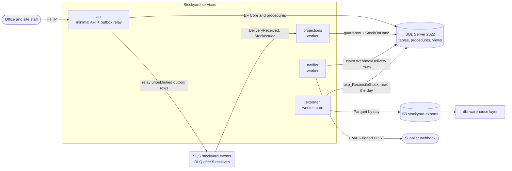
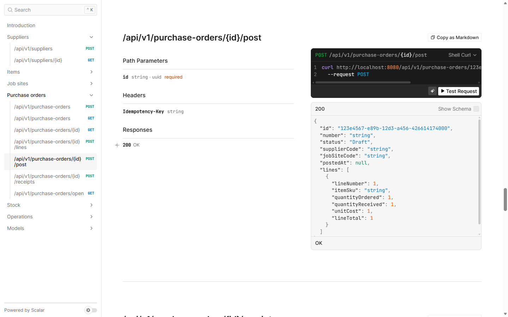
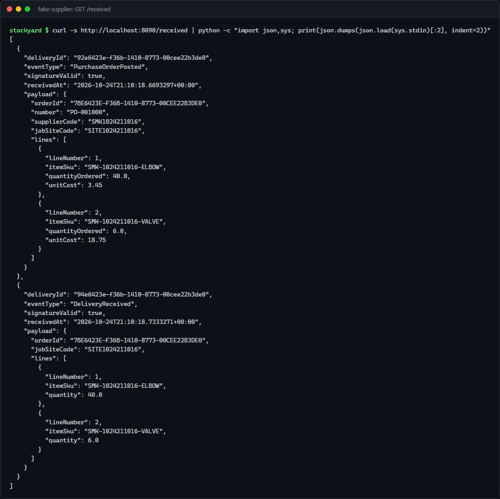
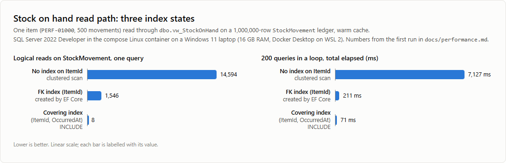
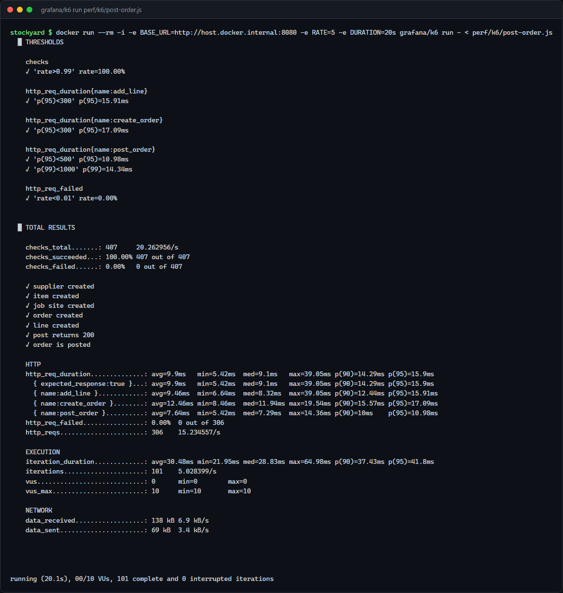

# Stockyard

Stockyard is an inventory and purchase-order ledger for a mechanical contractor. The office raises
purchase orders for pipe, fittings and valves, receives deliveries into stock at a job site or the
warehouse, issues stock to the work, and reconciles the stock on hand projection against the
movement ledger every night.

It is a personal project for practising production habits on one stack: .NET 10 on SQL Server
2022 with hand-written T-SQL where it matters, an outbox feeding an SQS queue with an idempotent
consumer, signed webhooks driven from database rows, Parquet exports to S3, and the AWS,
Kubernetes, Azure DevOps, dbt and k6 pieces to run and measure it.

## Architecture



A change and the record that it happened commit in one transaction: the procedures write the
`OutboxMessage` and `WebhookDelivery` rows next to the rows they change. Everything that leaves the
database is driven from those rows, so a crash leaves both or neither. The details, with the
outbox sequence diagram, the data model, the events and the failure table, are in
[docs/architecture.md](docs/architecture.md). The decisions behind it are in
[docs/decisions](docs/decisions/).

## Run it locally

Needs Docker. Three commands from the repository root:

```bash
cp .env.example .env
docker compose up --build -d
pwsh ./scripts/smoke.ps1        # or: bash ./scripts/smoke.sh (needs curl and jq)
```

Compose starts SQL Server, LocalStack 4.14 (the queue, its DLQ and the export bucket), runs the
migrations once through the api image (`migrate`), then starts the api on
[localhost:8080](http://localhost:8080/scalar/v1), the three workers and the fake supplier on
port 8090. The smoke script creates its own supplier, items and job site, posts an order twice
with the same `Idempotency-Key`, receives it, issues stock, waits for the projection, checks that
`GET /stock/reconcile` reports no differences, checks that the fake supplier received two
correctly signed webhooks, runs an export, and ends with `SMOKE PASSED`.

`bash ./scripts/seed.sh` (or `seed.ps1`) loads sample suppliers, job sites and items.
`docker compose down -v` removes everything again.

To build and test without the stack: `dotnet build Stockyard.sln -warnaserror` and
`dotnet test Stockyard.sln`. The integration tests start their own SQL Server and LocalStack
containers through Testcontainers, so Docker has to be running.

## API tour

With the stack up and the sample data loaded (`bash ./scripts/seed.sh`):

```bash
api=http://localhost:8080/api/v1

# A purchase order from Northgate Pipe Supply for the Riverside Clinic job
order=$(curl -s -X POST $api/purchase-orders -H 'Content-Type: application/json' \
  -d '{"supplierCode":"NGPS","jobSiteCode":"RIVERSIDE"}')
id=$(echo "$order" | jq -r .id)

curl -s -X POST $api/purchase-orders/$id/lines -H 'Content-Type: application/json' \
  -d '{"itemSku":"PIPE-CU-22","quantityOrdered":24}'
curl -s -X POST $api/purchase-orders/$id/lines -H 'Content-Type: application/json' \
  -d '{"itemSku":"valve-bv-25","quantityOrdered":6,"unitCost":17.90}'

# Post it. Sending the same key again returns the same order; another key is a 409.
curl -s -X POST $api/purchase-orders/$id/post -H 'Idempotency-Key: riverside-po-1' | jq '{number, status, postedAt}'
curl -s -X POST $api/purchase-orders/$id/post -H 'Idempotency-Key: riverside-po-1' | jq '{number, status, postedAt}'

# A partial delivery, then what is still outstanding
curl -s -X POST $api/purchase-orders/$id/receipts -H 'Content-Type: application/json' \
  -d '{"lines":[{"lineNumber":1,"quantity":24},{"lineNumber":2,"quantity":4}]}' | jq .status
curl -s $api/purchase-orders/open | jq '.[] | {number, lineNumber, itemSku, quantityOutstanding}'

# Issue to the work, then read stock on hand from the ledger
curl -s -X POST $api/stock/issues -H 'Content-Type: application/json' \
  -d '{"itemSku":"PIPE-CU-22","jobSiteCode":"RIVERSIDE","quantity":10,"reference":"WO-2207 level 3 risers"}'
curl -s "$api/stock/on-hand?itemSku=PIPE-CU-22"

# Issuing more than is there is a 409 with Problem Details
curl -s -X POST $api/stock/issues -H 'Content-Type: application/json' \
  -d '{"itemSku":"PIPE-CU-22","jobSiteCode":"RIVERSIDE","quantity":100,"reference":"WO-2208"}'

# Operations
curl -s $api/stock/reconcile                           # read only: differences, pending messages
curl -s -X POST "$api/exports/run?date=$(date -u +%F)"   # reconcile and export one UTC day
curl -s -X POST $api/outbox/dlq/replay                 # move dead letters back to the queue
curl -s http://localhost:8090/received | jq '.[] | {eventType, signatureValid}'
```

Every error is RFC 9457 Problem Details with an `errorNumber`. The full contract is the OpenAPI
document at `/openapi/v1.json`, browsable at `/scalar/v1` when `ASPNETCORE_ENVIRONMENT` is
`Development` (the default in `.env.example`).



The fake supplier checks every webhook's `X-Stockyard-Signature` against the shared secret before
recording it. After a smoke run, `GET /received` lists the two deliveries for the order, both
verified:



## What was measured here

Everything in this section was run on a Windows 11 laptop with 16 GB RAM, Docker Desktop on
WSL 2, SQL Server 2022 Developer in a Linux container.

- `dotnet build Stockyard.sln -warnaserror`: no warnings, with nullable, `latest-recommended`
  analyzers and code style enforced in the build.
- `dotnet test Stockyard.sln`: 193 tests pass, 118 unit and 75 integration. The integration tests
  run against `mcr.microsoft.com/mssql/server:2022-latest` and `localstack/localstack:4.14`. Among
  them:
  - `ExactlyOnceConsumptionTests`: the same message delivered twice, four concurrent deliveries,
    and a failure between the guard insert and the commit followed by a redelivery each change
    stock on hand exactly once;
  - `IssueStockTests.ConcurrentIssuesNeverOverdraw`: twelve tasks issue 2 units each against 10 in
    stock; exactly five succeed and the ledger ends at zero.
- `scripts/smoke.ps1` and `scripts/smoke.sh` against `docker compose up --build -d`: both end with
  `SMOKE PASSED`.
- The stock on hand read for one item over 1,000,000 ledger rows, warm cache, 200 parameterised
  queries per state ([docs/performance.md](docs/performance.md), `scripts/perf/measure.ps1`):

  | Index state | Logical reads | Average per query |
  | --- | --- | --- |
  | no index leading with `ItemId` | 14,594 | 35.3 to 36.3 ms |
  | EF Core's foreign key index on `ItemId` | 1,546 | 0.91 to 1.06 ms |
  | covering index `(ItemId, OccurredAt) INCLUDE (Quantity, JobSiteId)`, the one that ships | 8 | 0.35 to 0.42 ms |

  The ranges cover three runs of the script. The first:

  

- `usp_ReconcileStock` over the same ledger: 986 ms when it corrected all 42,000 item and site
  pairs, about 350 ms when there was nothing to correct.
- k6 against the compose stack, through the `grafana/k6` image:
  - `perf/k6/post-order.js` at 5 orders per second for 20 seconds (create, add a line, post):
    101 orders, 407 of 407 checks, no failed requests, posting p95 10.98 ms and p99 14.34 ms;
  - `perf/k6/stock-on-hand.js` at 50 reads per second for a minute: 3,009 requests, no failures,
    no dropped iterations, p95 5.6 ms.

  This is one laptop running every container, the api as a single instance. It shows the scripts
  and thresholds work end to end; it is not a capacity figure for a deployment.

  

## Pending a deployment

These need the AWS environment and were not measured. Each one, with the command to take it:

| Measurement | How |
| --- | --- |
| Stock on hand read on RDS SQL Server | migrate a `StockyardPerf` database with `docker run --rm -e "ConnectionStrings__Stockyard=<RDS connection string>" stockyard-api migrate`, then run `scripts/perf/seed-movements.sql` and `scripts/perf/measure.sql` with `sqlcmd -S <rds endpoint> -d StockyardPerf -v Stage=<none, fk or covering> Sku=PERF-01000` |
| api latency and throughput through the load balancer | the k6 scripts in `perf/k6/` through the `grafana/k6` image, for example `docker run --rm -i grafana/k6 run - < perf/k6/post-order.js` with the api URL set as described in `perf/k6/README.md` |
| Outbox lag on SQS | after a k6 run, `GET /api/v1/stock/reconcile` until `pendingMessages` and `unpublishedOutboxMessages` reach zero, and `aws sqs get-queue-attributes --queue-url <stockyard-events url> --attribute-names ApproximateNumberOfMessages ApproximateAgeOfOldestMessage` during the run |
| Exporter run time against S3 | `kubectl -n stockyard logs deploy/stockyard-exporter` after the 02:00 UTC run, or time `curl -X POST <api>/api/v1/exports/run?date=<yyyy-MM-dd>` |
| Pipeline duration and monthly cost | the run history of `azure-pipelines.yml`, and the cost table in `docs/platform.md` once the resources have run for a month |

## The platform half

**`infra/terraform/`** provisions the AWS side: a network, an EKS cluster with IRSA roles per
service, RDS SQL Server, the `stockyard-events` queue and its DLQ, the export bucket, ECR
repositories, secrets and observability. Each service's role carries only the access in the
least privilege table, so the notifier has no SQS permissions at all.

**`deploy/k8s/`** holds the Kubernetes manifests: a base with one Deployment and ServiceAccount per
image, the api Service, HPA and PDB, the `stockyard-config` ConfigMap and hardened pod security,
plus a local overlay for Docker Desktop or kind and an AWS overlay with ECR images, IRSA
annotations and secrets mounted through the Secrets Store CSI driver. The migration runs as the
`stockyard-migrate` Job with the api image and `migrate` as its args.

**`azure-pipelines.yml` and `.azure-pipelines/`** build and test the solution, build and scan the four
images in parallel and push them to ECR, then plan and, behind an environment approval, apply the
Terraform and roll out the manifests.

**`pipeline/dbt/`** is a dbt-duckdb project over the Parquet exports, with staging models, a star
schema and tests; it runs against a generated sample in the exporter's layout or against the S3
bucket.

**`perf/k6/`** has the load scripts for posting orders and reading stock on hand, with thresholds,
using the request bodies the api accepts.

The AWS topology, the least privilege table, the pipeline stages and the costs are in
`docs/platform.md`; first deploy, secret rotation, DLQ replay, rollback and teardown are in
`docs/runbook.md`.

## Repository layout

```
Stockyard.sln, Directory.Build.props, Directory.Packages.props, global.json
src/
  Stockyard.Domain/          entities, rules, event payloads, webhook signature and retry policy
  Stockyard.Infrastructure/  DbContext, migrations, Sql/*.sql (procedures, views, type, index),
                             procedure wrapper, view queries, outbox store
  Stockyard.Messaging/       envelope, SQS and in-memory bus, outbox relay, guarded consumer
  Stockyard.Api/             minimal API, Problem Details, health checks, OpenAPI, migrate command
  Stockyard.Projections/     worker that keeps StockOnHand
  Stockyard.Notifier/        worker that signs and sends supplier webhooks
  Stockyard.Exporter/        worker that reconciles and exports Parquet
tests/
  Stockyard.UnitTests/       xunit v3 and Shouldly
  Stockyard.IntegrationTests/ Testcontainers (SQL Server, LocalStack) and WebApplicationFactory
tools/FakeSupplier/          webhook receiver used by compose and the smoke tests
scripts/                     migrate, seed, smoke (PowerShell and bash), perf/, localstack/
docker-compose.yml, .env.example
docs/                        architecture, performance, decisions
infra/, deploy/, azure-pipelines.yml, .azure-pipelines/, pipeline/, perf/   the platform half
```

## Licence

MIT. See [LICENSE](LICENSE).
