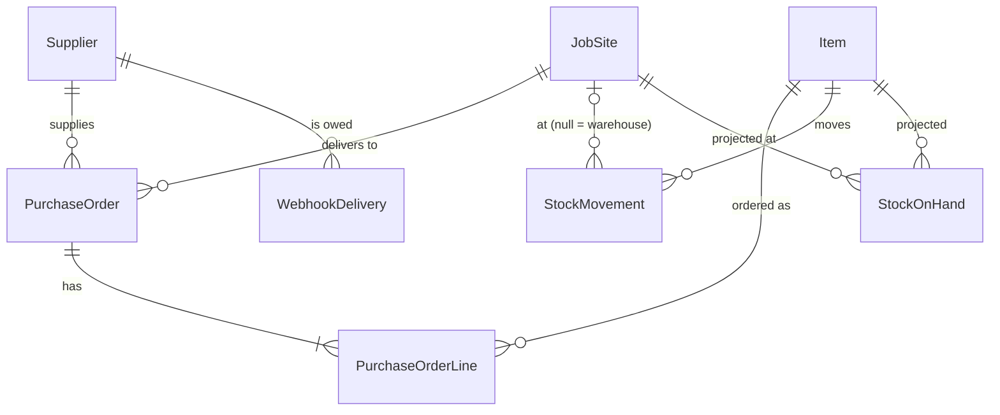

# Architecture

Stockyard keeps the purchase orders and the stock ledger for a mechanical contractor. The office
raises orders for pipe, fittings and valves, receives deliveries into stock at a job site or the
warehouse, issues stock to the work, and checks every night that the stock on hand projection
still agrees with the ledger.

The design rule throughout: a business change and the record that it happened commit in the same
SQL Server transaction. Everything that leaves the database (queue messages, webhooks, export
files) is driven from rows that transaction wrote, so a crash at any point leaves either both or
neither.

## Components

| Component | Kind | Does | Reads | Writes |
| --- | --- | --- | --- | --- |
| `Stockyard.Api` | ASP.NET Core minimal API, port 8080 | Master data, purchase orders, receipts, stock issues, reads, operations endpoints. Hosts the outbox relay. `dotnet Stockyard.Api.dll migrate` applies the migrations and exits. | SQL Server; SQS queue attributes (pending count) | SQL Server (EF Core and the procedures); SQS `stockyard-events` (relay); S3 export prefix (on-demand export); moves DLQ messages back on request |
| `Stockyard.Projections` | Worker | The only consumer of `stockyard-events`. Applies `DeliveryReceived` and `StockIssued` to `StockOnHand` behind the `ProcessedMessage` guard. | SQS `stockyard-events` | SQL Server (`ProcessedMessage`, `StockOnHand`) |
| `Stockyard.Notifier` | Worker | Claims due `WebhookDelivery` rows with a lease, signs and posts them, retries with backoff. | SQL Server | SQL Server (delivery outcomes); supplier webhook URLs |
| `Stockyard.Exporter` | Worker | On `Exporter__Cron` runs the reconcile, then writes the previous UTC day as Parquet. The api runs the same job on demand. | SQL Server | SQL Server (corrections, `StockReconciled` outbox row); S3 or a folder |
| `tools/FakeSupplier` | ASP.NET Core, port 8090, compose only | Receives webhooks, verifies the signature from the documented format, lists them at `GET /received`. | | memory |

Shared libraries: `Stockyard.Domain` (entities, rules, event payloads, webhook signature and retry
policy, no I/O), `Stockyard.Infrastructure` (EF Core context and migrations, the hand-written SQL,
the procedure wrapper, view queries, the outbox store) and `Stockyard.Messaging` (envelope, bus,
relay, consumer).

## Data model

EF Core owns the tables. The procedures, the table type, the two views and the covering index are
hand-written T-SQL in `src/Stockyard.Infrastructure/Sql/`, one object per file, embedded in the
assembly and installed by the `SqlObjects` migration after `InitialSchema`.



| Table | Notes |
| --- | --- |
| `Supplier`, `Item`, `JobSite` | Codes are unique, at most 16 characters (32 for SKUs), upper-cased by the api. The `JobSite` row with the empty GUID and code `WAREHOUSE` is stock held off site; the initial migration inserts it and the api refuses the code for new sites. |
| `PurchaseOrder` | `Number` comes from the `dbo.PurchaseOrderNumber` sequence (`PO-001000`, ...). `Status` is a tinyint: Draft 0, Posted 1, PartiallyReceived 2, Received 3, Cancelled 4. `IdempotencyKey` is unique where not null. `RowVersion` guards EF updates. |
| `PurchaseOrderLine` | `LineTotal` is a persisted computed column, `QuantityOrdered * UnitCost`. |
| `StockMovement` | The ledger and the source of truth. Quantities are signed. `JobSiteId` is null for the warehouse. |
| `StockOnHand` | The projection, keyed on (ItemId, JobSiteId) with the empty GUID for the warehouse. |
| `OutboxMessage` | Events waiting for the relay; a filtered index covers unpublished rows. |
| `ProcessedMessage` | The consumer guard, keyed on (ConsumerName, MessageId). |
| `WebhookDelivery` | Webhooks owed to suppliers; `NextAttemptAt` doubles as the claim lease. |

| SQL object | Purpose |
| --- | --- |
| `dbo.usp_PostPurchaseOrder` | Posts a draft under an idempotency key; writes `PurchaseOrderPosted` and the webhook row. |
| `dbo.ReceiptLineType`, `dbo.usp_ReceiveDelivery` | Records a delivery: receipt movements, received quantities, status, `DeliveryReceived` and the webhook row. |
| `dbo.usp_IssueStock` | Checks the balance under an application lock per item and site, writes the issue and `StockIssued`. |
| `dbo.usp_ReconcileStock` | Compares the projection with the ledger and, unless `@Apply = 0`, corrects it and writes `StockReconciled`. |
| `dbo.vw_StockOnHand` | Stock on hand summed from the ledger; the read behind `GET /stock/on-hand`. |
| `dbo.vw_OpenPurchaseOrders` | Posted lines with quantity outstanding. |
| `IX_StockMovement_ItemId_OccurredAt` | Covering index for per-item ledger reads; replaces EF's single-column foreign key index (see [performance](performance.md)). |

Business errors are raised with `THROW` and the same numbers the domain uses: 50000 validation,
50001 posted under another key, 50002 over-receipt, 50003 insufficient stock, 50004 not found,
50005 wrong status. One handler in the api maps them, together with unique key violations, to
RFC 9457 Problem Details.

## Events

One SQS standard queue, `stockyard-events`, with a `type` message attribute and a dead letter queue
`stockyard-events-dlq` after 5 receives. The body is the envelope
`{ messageId, type, occurredAt, payload }`, where `messageId` is the outbox row id. Payloads are
camelCase JSON written by the procedures with `FOR JSON PATH`.

| Event | Written by | Payload | Consumed by |
| --- | --- | --- | --- |
| `PurchaseOrderPosted` | `usp_PostPurchaseOrder` | `orderId, number, supplierCode, jobSiteCode, lines[lineNumber, itemSku, quantityOrdered, unitCost]` | projections (guard row only); the supplier webhook |
| `DeliveryReceived` | `usp_ReceiveDelivery` | `orderId, jobSiteCode, lines[lineNumber, itemSku, quantity]` | projections (adds to `StockOnHand`); the supplier webhook |
| `StockIssued` | `usp_IssueStock` | `itemSku, jobSiteCode, quantity, reference` (quantity positive) | projections (subtracts) |
| `StockReconciled` | `usp_ReconcileStock`, run by the exporter | `differences[itemSku, jobSiteCode, projected, actual]` | projections (guard row only); informational |

Webhooks do not come off the queue. A queue is point to point, so a second consumer would see
only part of the stream; the procedures write a `WebhookDelivery` row next to the outbox row
instead ([ADR 0004](decisions/0004-webhooks-from-delivery-rows.md)).

## The outbox

```mermaid
sequenceDiagram
    autonumber
    participant Client
    participant Api as api
    participant Sql as SQL Server
    participant Relay as outbox relay (in the api)
    participant Sqs as SQS stockyard-events
    participant Proj as projections

    Client->>Api: POST /purchase-orders/{id}/receipts
    Api->>Sql: EXEC usp_ReceiveDelivery
    Note over Sql: one transaction: lines, Receipt movements,<br/>status, OutboxMessage, WebhookDelivery
    Sql-->>Api: committed
    Api-->>Client: 200 order
    loop every Outbox__PollInterval
        Relay->>Sql: claim unpublished rows (UPDLOCK, READPAST)
        Relay->>Sqs: SendMessage (type attribute)
        Relay->>Sql: mark PublishedAt, commit
    end
    Proj->>Sqs: ReceiveMessage (long poll)
    Proj->>Sql: BEGIN; INSERT ProcessedMessage; UPDATE StockOnHand; COMMIT
    Proj->>Sqs: DeleteMessage
```

The relay is at least once: if it crashes after `SendMessage` and before its commit, the row is
sent again. The consumer guard turns that into exactly once for the projection: the second
`INSERT ProcessedMessage` fails on the primary key, the transaction rolls back, and the message is
deleted ([ADR 0001](decisions/0001-outbox-over-dual-writes.md),
[ADR 0003](decisions/0003-idempotency-keys-and-processed-message-guard.md)).

## Request flow

A request to post an order shows the layers:

1. `POST /api/v1/purchase-orders/{id}/post` with `Idempotency-Key`. The endpoint checks the header
   is 1 to 64 characters (400 otherwise).
2. `StockyardProcedures.PostPurchaseOrderAsync` runs `usp_PostPurchaseOrder`. It locks the order
   row with `UPDLOCK, HOLDLOCK`; the same key on a posted order returns without changes, another
   key raises 50001.
3. A `THROW` between 50000 and 50005 comes back as a `DomainException` with the same number; the
   exception handler turns it into Problem Details with the mapped status.
4. On success the endpoint reads the order back in one projection query and returns 200. A retried
   request returns the identical body.

Reads go through the views: `GET /stock/on-hand` queries `vw_StockOnHand`, the ledger itself,
while `StockOnHand` exists for consumers that want a cheap lookup and for the reconcile.

## Configuration

Environment variables use `__` for nesting.

| Key | Used by | Default | Notes |
| --- | --- | --- | --- |
| `ConnectionStrings__Stockyard` | all | | Required. |
| `Messaging__Provider` | api, projections | `Sqs` | `InMemory` keeps everything in one process (tests). |
| `Messaging__QueueUrl` | api, projections | | Required for SQS. |
| `Messaging__DlqUrl` | api | | Needed by `POST /outbox/dlq/replay`. |
| `Messaging__ServiceUrl` | api, projections | empty | LocalStack endpoint; empty on AWS. |
| `Outbox__PollInterval` | api | `00:00:01` | Sleep when the last batch was not full. |
| `Outbox__BatchSize` | api | `50` | 1 to 500. |
| `Notifier__SigningSecret` | notifier | | Required. Shared with each supplier. |
| `Notifier__PollInterval` | notifier | `00:00:02` | |
| `Notifier__BatchSize` | notifier | `20` | |
| `Notifier__Lease` | notifier | `00:01:00` | Must be longer than the request timeout. |
| `Notifier__RequestTimeout` | notifier | `00:00:10` | |
| `Exporter__Destination` | exporter, api | | Required. A folder or `s3://bucket/prefix`. |
| `Exporter__Cron` | exporter | `0 2 * * *` | Five fields, UTC. |
| `Exporter__ServiceUrl` | exporter, api | empty | LocalStack S3 endpoint; empty on AWS. |
| `AWS_REGION` | api, projections, exporter | | `us-east-1` locally and in Terraform. Credentials come from the SDK chain (IRSA on EKS). |

## Failure behaviour

| What fails | What happens |
| --- | --- |
| SQL Server is not up yet | `migrate` retries the connection every 3 s for about a minute before giving up; the services wait for it to finish. `/readyz` fails while SQL Server is unreachable, `/healthz` does not. |
| The api crashes after a procedure commits | The change, the outbox row and the webhook row are all committed; the relay and the notifier pick them up on the next poll. |
| SQS is unreachable | The relay records the error on the row (`Attempts`, `LastError`), stops the batch, and tries again on the next poll. Orders, receipts and issues keep working; `GET /stock/reconcile` reports the unpublished count. |
| The relay crashes between send and commit | The rows are sent again; the projections guard drops the duplicates. |
| The projections worker crashes mid-message | The transaction rolls back, so neither the guard row nor the change survives. The message becomes visible again and is applied once. Proven by `ExactlyOnceConsumptionTests`. |
| A message keeps failing | It is released with a growing visibility delay; after 5 receives SQS moves it to the DLQ. `POST /outbox/dlq/replay` moves it back once the cause is fixed. |
| A supplier endpoint is down | The delivery is retried after 1 s, 2 s, 4 s, ... capped at 10 minutes, for 8 attempts, then left with `LastError`. `POST /webhooks/{id}/replay` queues it again. |
| A notifier dies holding a lease | The rows reappear when the lease (`Notifier__Lease`) expires and another replica sends them. |
| Two issues race for the last units | `usp_IssueStock` serialises them on an application lock per item and site; the loser gets 409 (50003). `IssueStockTests.ConcurrentIssuesNeverOverdraw` runs twelve at once. If the lock is not granted in 10 s the api answers 503. |
| The projection drifts from the ledger | The nightly reconcile corrects it in its own transaction and writes `StockReconciled`. Pairs with events still in flight are skipped ([ADR 0005](decisions/0005-reconcile-corrects-in-the-procedure.md)). On the one million movement perf ledger the correcting run took under a second ([performance](performance.md#the-reconcile-on-the-same-ledger)). |
| The export destination is unavailable | The run logs the error; the reconcile part has already committed. The next scheduled run exports the following day, so a missed day is re-run with `POST /exports/run?date=`. |
