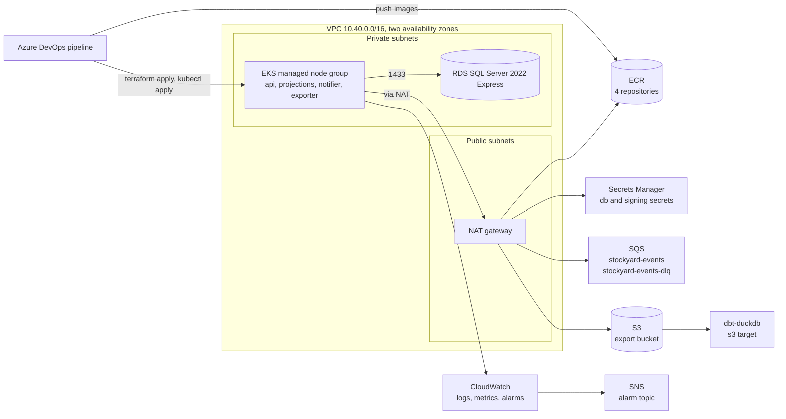

# Platform

How Stockyard runs on AWS: what Terraform creates, who can touch what, how the Kubernetes manifests are put together, what the pipeline does, how the warehouse layer reads the exports, and what it all costs while it exists. Operating procedures are in [runbook.md](runbook.md); the reasoning behind the larger choices is in the ADRs under [decisions/](decisions/) (0101 to 0105).

## AWS topology

Everything lives in one region (us-east-1) and one VPC spread over two availability zones. The services run on EKS in private subnets; SQL Server runs on RDS in the same private subnets and only accepts connections from the nodes. Outbound traffic from the nodes (to SQS, S3, Secrets Manager, ECR, and the EKS API) leaves through a single NAT gateway.



There is no load balancer or ingress: the api Service is `ClusterIP` and is reached with `kubectl port-forward`. Putting it on the internet would mean the AWS Load Balancer Controller, an Ingress, a certificate, and authentication in front of the API, none of which the project needs yet.

## Terraform layout

`infra/terraform` is one root module that wires seven child modules together. State is in S3 with the native S3 lockfile (`use_lockfile = true`); the bucket, key, and region are passed at `terraform init` so nothing account specific is committed.

| Path | What it creates |
| ----- | ----- |
| `versions.tf`, `providers.tf`, `backend.tf` | Terraform 1.10 or later, AWS provider 6.x with default tags, partial S3 backend |
| `main.tf` | Availability zone lookup, naming, and the module calls |
| `secrets.tf` | Secrets Manager secrets for `ConnectionStrings__Stockyard` and `Notifier__SigningSecret` (containers only; values are written out of band) |
| `variables.tf`, `example.tfvars` | Every input with a description, a default where one is safe, and validation |
| `outputs.tf` | Queue URLs, bucket, ECR URLs, IRSA role ARNs, secret names, and `k8s_aws_env` (the aws overlay's env file) |
| `modules/network` | VPC, public and private subnets per zone with the EKS discovery tags, internet gateway, one NAT gateway, route tables |
| `modules/eks` | Cluster role and control plane (API authentication mode, control plane logs with retention), managed node group on AL2023, core add-ons (VPC CNI with network policy enforcement, kube-proxy, CoreDNS), access entries for admins, and `irsa.tf`: the OIDC provider and one role per service account |
| `modules/rds` | DB subnet group, security group open to the cluster security group only, SQL Server Express instance with encrypted gp3 storage and an RDS managed master password |
| `modules/messaging` | `stockyard-events` and `stockyard-events-dlq` (redrive after 5 receives, only the events queue may redrive into the DLQ, SSE on both) |
| `modules/storage` | Export bucket: public access blocked, bucket owner enforced, SSE, TLS-only policy, exports expire after `export_retention_days` |
| `modules/registry` | Four ECR repositories with immutable tags, scan on push, and a lifecycle policy |
| `modules/observability` | SNS alarm topic (optional email), alarms on DLQ depth, events backlog age, database CPU and free storage, and Container Insights through the EKS add-on with its own IRSA role |
| `tests/variables.tftest.hcl` | `terraform test` against a mocked AWS provider: a default plan and the variable validations |

Checks that run without an AWS account:

```
terraform -chdir=infra/terraform fmt -check -recursive
terraform -chdir=infra/terraform init -backend=false
terraform -chdir=infra/terraform validate
terraform -chdir=infra/terraform test
```

`.terraform.lock.hcl` is committed with hashes for linux_amd64, windows_amd64, and darwin_arm64 so the pipeline agent and a laptop resolve the same provider build.

## Least privilege

Each Kubernetes service account has its own IAM role (IRSA), trusted only by `system:serviceaccount:stockyard:<name>`. The table is kept in step with `infra/terraform/modules/eks/irsa.tf` by hand, so change both together.

| Service account | What the service does with AWS | Granted for the service | Granted for the CSI secret mount (ADR 0105) |
| ----- | ----- | ----- | ----- |
| `stockyard-api` (also runs the migrate job) | Relays outbox rows to the queue; replays the DLQ back onto it; reads the pending count for `/stock/reconcile`; writes on-demand exports | `sqs:SendMessage`, `sqs:GetQueueAttributes` on `stockyard-events`; `sqs:ReceiveMessage`, `sqs:DeleteMessage`, `sqs:GetQueueAttributes` on `stockyard-events-dlq`; `s3:PutObject` on `<bucket>/exports/*` | `secretsmanager:GetSecretValue`, `DescribeSecret` on the db secret |
| `stockyard-projections` | Only consumer of the events queue | `sqs:ReceiveMessage`, `sqs:DeleteMessage`, `sqs:ChangeMessageVisibility`, `sqs:GetQueueAttributes` on `stockyard-events` | same, db secret |
| `stockyard-notifier` | Signs and sends webhooks from `WebhookDelivery` rows; never reads the queue (ADR 0004) | none beyond the mounts | db secret, and `GetSecretValue`, `DescribeSecret` on the signing secret |
| `stockyard-exporter` | Writes the nightly Parquet files; `StockReconciled` goes out through the outbox and the api relay | `s3:PutObject` on `<bucket>/exports/*` | same, db secret |
| `amazon-cloudwatch/cloudwatch-agent` | Container Insights metrics and logs | `CloudWatchAgentServerPolicy` | none |

What no workload can do: read the RDS master password secret, touch the DLQ (except the api's replay), read from the export bucket, delete anything in S3, or call any AWS API outside those listed. The nodes' own role has only the three EKS worker policies (worker node, CNI, ECR pull only).

Other boundaries:

* SQL Server accepts 1433 only from the EKS cluster security group, and has no public address.
* Cluster access is through EKS access entries for the principals in `cluster_admin_principal_arns` (the pipeline role and an admin role); the cluster creator does not get implicit admin.
* The `stockyard` namespace enforces the restricted Pod Security Standard, and a default deny NetworkPolicy leaves only port 8080 on the api pods open.

## Kubernetes

`deploy/k8s` is plain manifests with kustomize: a base and two overlays.

| Layer | Contents |
| ----- | ----- |
| `base` | Namespace `stockyard` (restricted Pod Security, enforce, audit, and warn); the `stockyard-config` ConfigMap generated from `config.env`; one ServiceAccount and Deployment per image (`stockyard-api`, `stockyard-projections`, `stockyard-notifier`, `stockyard-exporter`); the api Service, HPA (CPU 70 %, 2 to 6 pods), and PodDisruptionBudget (one pod always up); the `stockyard-migrate` Job; NetworkPolicies |
| `overlays/local` | Docker Desktop or kind. Images tagged `local`, plain Secrets with the compose values, LocalStack and SQL Server reached through `host.docker.internal`, LocalStack credentials, one api pod |
| `overlays/aws` | EKS. ECR image names, IRSA role annotations, one SecretProviderClass per secret, CSI volumes mounted so the Secrets sync, `aws.env` with the real queue URLs and export destination (rendered from Terraform outputs at deploy time) |

Every pod runs as the image's non-root `app` user (UID 1654) with `runAsNonRoot`, the `RuntimeDefault` seccomp profile, no privilege escalation, all capabilities dropped, and a read-only root filesystem with an `emptyDir` at `/tmp`. Service account tokens are not mounted; IRSA injects its own projected token. Every container has requests and limits.

The api has a liveness probe on `/healthz` (no dependencies, so a database outage never restarts it) and a readiness probe on `/readyz` (checks SQL Server). The workers listen on nothing and have no probes. The exporter uses the `Recreate` strategy so a rollout never runs two schedulers at 02:00 UTC.

Configuration reaches the containers with `envFrom`: the ConfigMap `stockyard-config` and the Secrets `stockyard-db` (`ConnectionStrings__Stockyard`) and, for the notifier, `stockyard-signing` (`Notifier__SigningSecret`). On AWS those Secrets are created by the Secrets Store CSI driver from Secrets Manager when a pod mounts its SecretProviderClass; locally they are plain Secrets. `Messaging__ServiceUrl` and `Exporter__ServiceUrl` point at LocalStack in the local overlay and are empty on AWS, where the SDK uses the regional endpoints.

Migrations run as the Job `stockyard-migrate`: the api image with `args: ["migrate"]` under the api's service account. A Job's pod template is immutable, so a deploy deletes the previous Job, applies the new one, waits for it to complete, and only then rolls the Deployments.

Render either overlay without a cluster:

```
kubectl kustomize deploy/k8s/overlays/local
kubectl kustomize deploy/k8s/overlays/aws
```

## Pipeline

`azure-pipelines.yml` with step templates in `.azure-pipelines/steps/`. Its header lists the extension, service connection, variable group entries, and environment it needs.

| Stage | Runs on | Jobs | Template |
| ----- | ----- | ----- | ----- |
| Build | every PR and push to main | Restore (NuGet cache keyed on `Directory.Packages.props`), build with `-warnaserror`, test on Microsoft.Testing.Platform with the xunit TRX report, publish results | `dotnet.yml` |
| Package | main only | Four matrix jobs in parallel, one per image: `docker build` from the repository root, Trivy scan failing on fixable HIGH or CRITICAL, push to ECR tagged with the commit SHA | `docker-ecr.yml` |
| Deploy | main only | `plan`: Terraform plan into a file, published with a readable copy. `apply`: deployment job on the `stockyard-aws` environment (approval check), applies that exact plan, renders the aws overlay with the account, environment, and image tag, runs the migration Job, then rolls the Deployments | `terraform.yml`, `kubectl.yml` |

The pipeline has not been run against a real Azure DevOps organisation from this repository, so there are no recorded run durations. Validating it means creating the project, the service connection, variable group, and environment listed in the header, and queuing a run on main.
