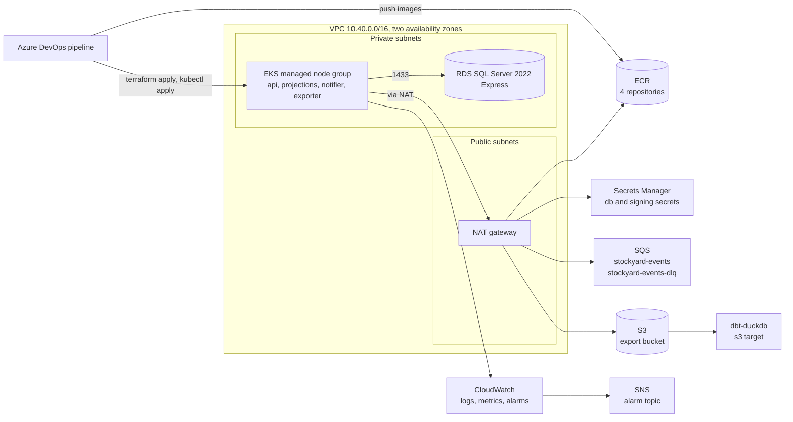

# Platform

How Stockyard runs on AWS: what Terraform creates, who can touch what, how the Kubernetes manifests are put together, what the pipeline does, how the warehouse layer reads the exports, and what it all costs while it exists. Operating procedures are in [runbook.md](runbook.md); the reasoning behind the larger choices is in the ADRs under [decisions/](decisions/) (0101 to 0105).

## AWS topology

Everything lives in one region (us-east-1) and one VPC spread over two availability zones. The services run on EKS in private subnets; SQL Server runs on RDS in the same private subnets and only accepts connections from the nodes. Outbound traffic from the nodes (to SQS, S3, Secrets Manager, ECR, and the EKS API) leaves through a single NAT gateway.



There is no load balancer or ingress: the api Service is `ClusterIP` and is reached with `kubectl port-forward`. Putting it on the internet would mean the AWS Load Balancer Controller, an Ingress, a certificate, and authentication in front of the API, none of which the project needs yet.

## Terraform layout

`infra/terraform` is one root module that wires seven child modules together. State is in S3 with the native S3 lockfile (`use_lockfile = true`); the bucket, key, and region are passed at `terraform init` so nothing account specific is committed.

| Path | What it creates |
| ----- | ----- |
| `versions.tf`, `providers.tf`, `backend.tf` | Terraform 1.10 or later, AWS provider 6.x with default tags, partial S3 backend |
| `main.tf` | Availability zone lookup, naming, and the module calls |
| `secrets.tf` | Secrets Manager secrets for `ConnectionStrings__Stockyard` and `Notifier__SigningSecret` (containers only; values are written out of band) |
| `variables.tf`, `example.tfvars` | Every input with a description, a default where one is safe, and validation |
| `outputs.tf` | Queue URLs, bucket, ECR URLs, IRSA role ARNs, secret names, and `k8s_aws_env` (the aws overlay's env file) |
| `modules/network` | VPC, public and private subnets per zone with the EKS discovery tags, internet gateway, one NAT gateway, route tables |
| `modules/eks` | Cluster role and control plane (API authentication mode, control plane logs with retention), managed node group on AL2023, core add-ons (VPC CNI with network policy enforcement, kube-proxy, CoreDNS), access entries for admins, and `irsa.tf`: the OIDC provider and one role per service account |
| `modules/rds` | DB subnet group, security group open to the cluster security group only, SQL Server Express instance with encrypted gp3 storage and an RDS managed master password |
| `modules/messaging` | `stockyard-events` and `stockyard-events-dlq` (redrive after 5 receives, only the events queue may redrive into the DLQ, SSE on both) |
| `modules/storage` | Export bucket: public access blocked, bucket owner enforced, SSE, TLS-only policy, exports expire after `export_retention_days` |
| `modules/registry` | Four ECR repositories with immutable tags, scan on push, and a lifecycle policy |
| `modules/observability` | SNS alarm topic (optional email), alarms on DLQ depth, events backlog age, database CPU and free storage, and Container Insights through the EKS add-on with its own IRSA role |
| `tests/variables.tftest.hcl` | `terraform test` against a mocked AWS provider: a default plan and the variable validations |

Checks that run without an AWS account:

```
terraform -chdir=infra/terraform fmt -check -recursive
terraform -chdir=infra/terraform init -backend=false
terraform -chdir=infra/terraform validate
terraform -chdir=infra/terraform test
```

`.terraform.lock.hcl` is committed with hashes for linux_amd64, windows_amd64, and darwin_arm64 so the pipeline agent and a laptop resolve the same provider build.
